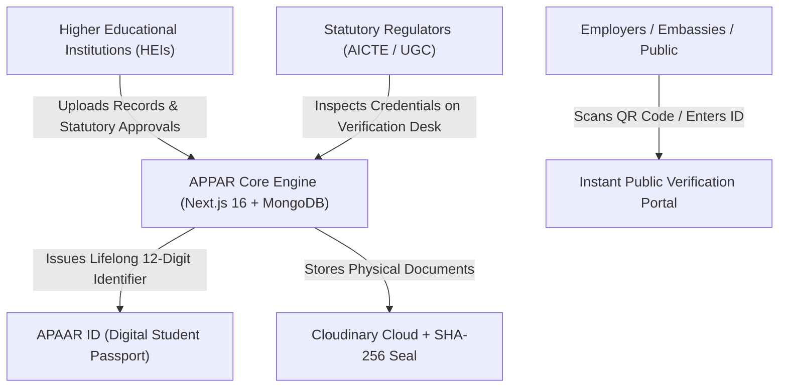
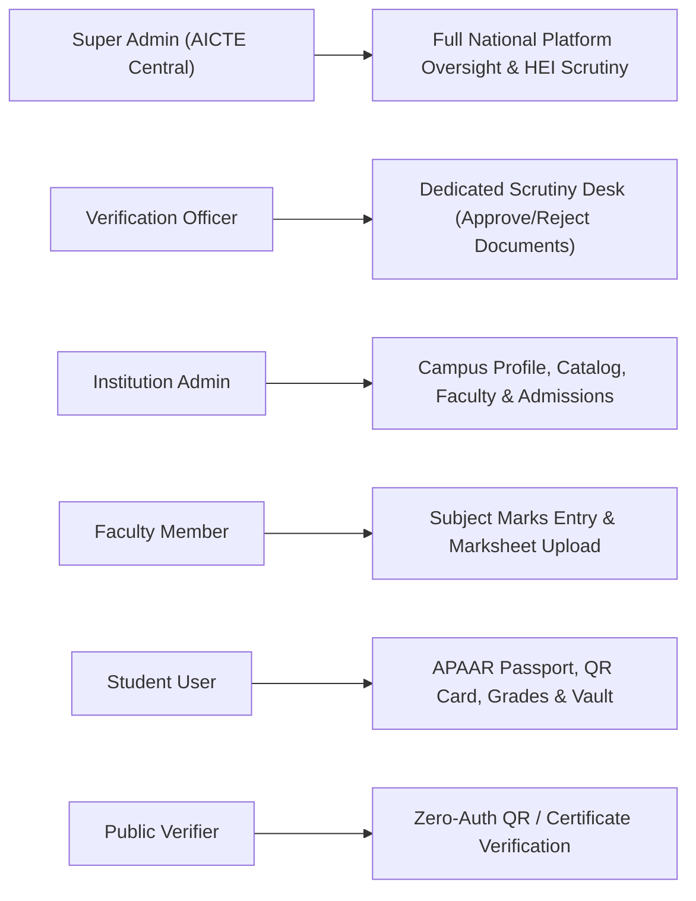
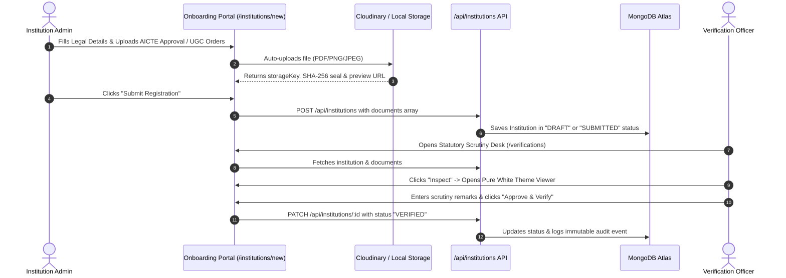
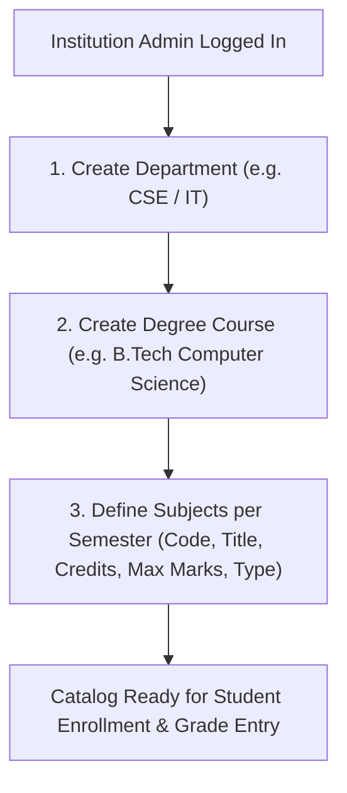
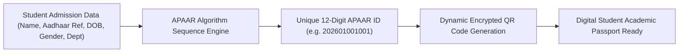
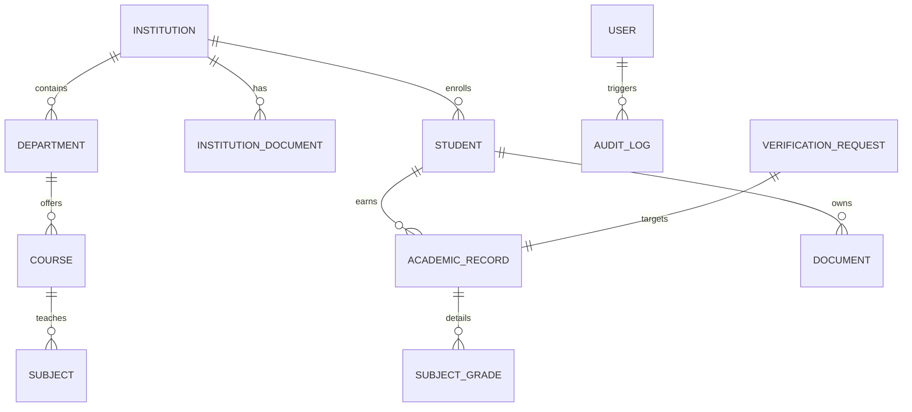

# APPAR Portal: Automated Permanent Academic Account Registry & Digital Academic Depository
## Comprehensive Technical Documentation, System Architecture & Operational Guide

---

## 1. Executive Summary & Product Vision

### 1.1 What is APPAR Portal?
The **APAAR Portal (Automated Permanent Academic Account Registry)** is a production-grade, multi-tenant higher education management and verification platform. Designed in accordance with India's **National Education Policy (NEP 2020)**, **All India Council for Technical Education (AICTE)** guidelines, and the **Academic Bank of Credits (ABC)** mandate, the platform serves as a unified, tamper-evident digital depository for student academic lifecycles.

### 1.2 Core Problems Solved
- **Counterfeit Credentials**: Eliminates fake degrees and altered marksheets through cryptographic SHA-256 integrity hashes and public QR attestation.
- **Inter-University Mobility**: Accelerates credit recognition when students transfer between universities under NEP 2020 multiple entry/exit pathways.
- **Institutional Accreditation Transparency**: Centralizes statutory regulatory credentials (AICTE EOA, UGC 2(f)/12(B) orders, and University Affiliations) with a dedicated Scrutiny Desk.
- **Error-Free Academic Calculation**: Automates UGC/AICTE 10-point scale grade computations, SGPA, and cumulative CGPA without manual human errors.



---

## 2. Technical Stack & System Architecture

### 2.1 Technology Architecture Matrix

| Layer | Technology | Version | Purpose |
| :--- | :--- | :--- | :--- |
| **Frontend Framework** | Next.js (App Router) | `16.0+` | Server Components, dynamic client views, and Turbopack bundler |
| **UI Library** | React | `19.0` | Declarative UI, state management, transitions |
| **Styling & Design** | Tailwind CSS | `3.4` | Responsive modern design, pure white statutory theme |
| **Icons & Visuals** | Lucide React | `^1.16` | UI icons across navigation and file viewers |
| **Backend Runtime** | Node.js | `v24+` | High-concurrency asynchronous runtime |
| **Database** | MongoDB Atlas | `v7.0+` | Cloud NoSQL document database with ACID replica sets |
| **Database ODM** | Mongoose | `^8.19` | Strongly typed schemas, subdocuments, and indexing |
| **File Storage** | Cloudinary & Local Fallback | Cloudinary API | Cloud storage of PDFs/images with `/api/institutions/preview` inline streaming |
| **Security & Hashing**| SHA-256 & bcryptjs | Native / `^3.0` | File cryptographic seals and salted password hashing |
| **Session Security** | Iron Session | `^8.0` | Stateless encrypted HTTP-only cookie authentication |
| **Data Validation** | Zod | `^4.1` | Compile-time & runtime schema validation |
| **Testing Harness** | Vitest & React Testing Lib | `^5.0` | Automated unit, schema, and integration tests |

### 2.2 Architectural Highlights
1. **Multi-Tenant Scoping**: All academic records, courses, subjects, and students are scoped strictly to an `institutionId`. Cross-tenant data access is blocked by middleware and database queries.
2. **Cryptographic File Sealing**: Whenever an institution or student marksheet is uploaded, the server calculates its SHA-256 digest (`crypto.createHash("sha256")`). Any byte alteration invalidates the seal.
3. **Pure White Theme Scrutiny Lightbox**: Custom statutory modal viewer rendering PDFs and images inline with fallback preview routes and zero dark-theme artifacts.
4. **Zero-Trust Audit Logging**: Every administrative action (`INSTITUTION_CREATED`, `RECORD_VERIFIED`, `DOCUMENT_DOWNLOADED`, `STUDENT_ENROLLED`) is recorded in an immutable MongoDB audit ledger with IP, User-Agent, and timestamps.

---

## 3. User Roles, Personas & Capabilities

The system enforces **Role-Based Access Control (RBAC)** across 5 distinct personas:



### Role Breakdown & Responsibilities

| Role | Default Email | Default Password | Key Capabilities |
| :--- | :--- | :--- | :--- |
| **Super Admin** | `admin@aicte.gov.in` | `Admin@123` | - Complete national dashboard visibility<br>- Approve / reject newly registered institutions<br>- View system-wide compliance and audit trails<br>- Configure national academic parameters |
| **Verification Officer** | `officer1@aicte.gov.in` | `Demo@12345` | - Statutory Scrutiny Desk (`/verifications`) access<br>- Inspect AICTE/UGC accreditation documents in White Theme Lightbox<br>- Approve, Reject, or Request Corrections with mandatory audit trail remarks |
| **Institution Admin** | `admin.nitt@nitt.edu`<br>`admin.gct@gct.ac.in` | `Demo@12345` | - Manage College Profile & AISHE credentials<br>- Upload statutory affiliation & EOA approval orders<br>- Create Departments, Degree Courses, and Subject Catalog<br>- Onboard students and issue 12-digit APAAR IDs |
| **Faculty Member** | `faculty.cse@nitt.edu`<br>`faculty.it@gct.ac.in` | `Demo@12345` | - Enter semester marks per subject (Theory/Lab)<br>- Auto-compute Grade Points and SGPA<br>- Upload stamped marksheet images/PDFs |
| **Student** | `arun.kumar@nitt.edu`<br>`karthik.raja@gct.ac.in` | `Demo@12345` | - View personal lifelong APAAR card with QR code<br>- Track verified semester marksheets and cumulative CGPA<br>- Download signed transcripts and Bonafide certificates |
| **Public Verifier** | *No Login Required* | *Public Access* | - Verify APAAR ID validity (`/verify`)<br>- Scan QR code on student cards for instant authenticity check |

---

## 4. End-to-End System Workflows

### 4.1 Workflow 1: Institution Registration & Statutory Document Scrutiny



---

### 4.2 Workflow 2: Academic Catalog Setup (Department -> Course -> Subject)



1. **Department Setup**: Admin specifies Department Name (e.g., Computer Science & Engineering) and Department Code (`CSE`).
2. **Course Definition**: Admin defines Degree Level, Duration (e.g., 4 Years, 8 Semesters), and links it to the Department.
3. **Subject Catalog**: Admin configures subjects per semester with statutory metadata:
   - `Code` (e.g., `CS201`)
   - `Name` (e.g., `Data Structures & Algorithms`)
   - `Credits` (e.g., `4`)
   - `Category` (`PCC` - Professional Core, `PEC` - Elective, `BSC` - Basic Science)
   - `Type` (`THEORY` or `PRACTICAL`)

---

### 4.3 Workflow 3: Student Onboarding & 12-Digit APAAR Generation



- **APAAR Generation Logic**: Generates an authoritative 12-digit sequential identifier compliant with Ministry of Education format:
  `YYYY` (Admission Year) + `II` (Institution State/District Prefix) + `NNNNNN` (Unique Sequential Index).
- **QR Code Binding**: Encodes a signed verification URL that allows any prospective employer to verify the student with a single camera scan.

---

### 4.4 Workflow 4: Grade Entry & Automated SGPA/CGPA Calculation

The platform implements the standard **UGC/AICTE 10-Point Letter Grading Scale**:

| Marks Range (%) | Letter Grade | Grade Point | Meaning |
| :---: | :---: | :---: | :--- |
| **90 – 100** | **O** | **10** | Outstanding |
| **80 – 89** | **A+** | **9** | Excellent |
| **70 – 79** | **A** | **8** | Very Good |
| **60 – 69** | **B+** | **7** | Good |
| **50 – 59** | **B** | **6** | Above Average |
| **45 – 49** | **C** | **5** | Pass |
| **40 – 44** | **P** | **4** | Marginal Pass |
| **< 40** | **F** | **0** | Reappear / Fail |

$$\text{SGPA} = \frac{\sum (\text{Credits} \times \text{Grade Point})}{\sum \text{Credits}}$$

$$\text{CGPA} = \frac{\sum (\text{Semester SGPA} \times \text{Semester Credits})}{\sum \text{Total Credits}}$$

---

## 5. Database Schema & Data Models

### 5.1 MongoDB Collections Overview



### 5.2 Key Model Definitions

#### 1. `Institution` Model
```typescript
{
  name: string;               // e.g., "National Institute of Technology, Tiruchirappalli"
  code: string;               // Unique uppercase code, e.g., "NITT-001"
  category: "ENGINEERING" | "POLYTECHNIC" | "MANAGEMENT" | "PHARMACY" | "ARTS_SCIENCE";
  address: {
    street: string;
    city: string;
    district: string;
    state: string;
    pincode: string;
  };
  contactEmail: string;
  contactPhone: string;
  principalName: string;
  approvalReference: string;  // e.g., "AICTE-TN-ENGG-2026-NITT"
  status: "DRAFT" | "SUBMITTED" | "UNDER_REVIEW" | "VERIFIED" | "REJECTED" | "CORRECTION_REQUIRED";
  documents: [
    {
      title: string;
      documentType: "AICTE_APPROVAL" | "UGC_RECOGNITION" | "AFFILIATION_CERTIFICATE" | "LAND_OWNERSHIP" | "GOV_NOC" | "OTHER";
      originalFileName: string;
      mimeType: string;
      fileSizeBytes: number;
      storageKey: string;
      storageProvider: "cloudinary" | "local";
      sha256Hash: string;
      url: string;
      uploadedAt: Date;
    }
  ];
  reviewerId?: ObjectId;
  reviewRemarks?: string;
  reviewedAt?: Date;
}
```

#### 2. `Student` Model
```typescript
{
  userId: ObjectId;
  institutionId: ObjectId;
  departmentId: ObjectId;
  registerNumber: string;     // e.g., "106122001"
  apaarId: string;            // 12-digit identifier, e.g., "202601001001"
  fullName: string;
  dateOfBirth: Date;
  gender: "MALE" | "FEMALE" | "OTHER";
  admissionYear: number;
  currentSemester: number;
  academicStatus: "ACTIVE" | "COMPLETED" | "DISCONTINUED";
}
```

#### 3. `AcademicRecord` Model
```typescript
{
  studentId: ObjectId;
  institutionId: ObjectId;
  academicYear: string;       // e.g., "2023-2024"
  semester: number;           // e.g., 3
  subjects: [
    {
      subjectId: ObjectId;
      subjectCode: string;
      subjectName: string;
      credits: number;
      marksObtained: number;
      maxMarks: number;
      grade: "O" | "A+" | "A" | "B+" | "B" | "C" | "P" | "F";
      gradePoint: number;
      result: "PASS" | "FAIL";
    }
  ];
  totalCredits: number;
  sgpa: number;
  status: "DRAFT" | "SUBMITTED" | "VERIFIED" | "REJECTED";
  version: number;
  verifiedAt?: Date;
}
```

---

## 6. Comprehensive API Reference

### 6.1 Authentication Endpoints

| Method | Endpoint | Access | Description |
| :--- | :--- | :--- | :--- |
| `POST` | `/api/auth/login` | Public | Authenticates credentials, creates encrypted HTTP-only session cookie |
| `POST` | `/api/auth/logout` | Authenticated | Clears iron-session cookie and terminates user session |
| `GET` | `/api/auth/session` | Authenticated | Returns current authenticated user profile, roles, and tenant metadata |

---

### 6.2 Institution & Statutory Document Endpoints

| Method | Endpoint | Access | Description |
| :--- | :--- | :--- | :--- |
| `GET` | `/api/institutions` | Auth | Paginated list of institutions with filtering by state, status, category |
| `POST` | `/api/institutions` | Super Admin | Registers a new institution with attached statutory documents array |
| `GET` | `/api/institutions/:id` | Auth | Retrieves complete institution profile including statutory documents |
| `PATCH` | `/api/institutions/:id` | Admin / Officer | Updates profile or modifies document list (`institution.markModified`) |
| `POST` | `/api/institutions/upload` | Admin / Officer | Uploads statutory PDF/image to Cloudinary; returns SHA-256 and stream URL |
| `GET` | `/api/institutions/preview` | Auth | Streams local or Cloudinary statutory document inline (`Content-Disposition: inline`) |
| `GET` | `/api/institutions/:id/documents/:docId/download` | Auth | Secure authenticated file download with audit trail logging |

---

### 6.3 Catalog & Student Endpoints

| Method | Endpoint | Access | Description |
| :--- | :--- | :--- | :--- |
| `GET/POST`| `/api/departments` | Inst Admin | Manage college academic departments |
| `GET/POST`| `/api/courses` | Inst Admin | Manage degree programs and duration |
| `GET/POST`| `/api/subjects` | Inst Admin | Manage course curriculum subjects and credit values |
| `GET/POST`| `/api/students` | Inst Admin | List students or onboard new student with 12-digit APAAR generation |
| `GET` | `/api/students/:id` | Auth | View student academic portfolio and transcripts |

---

### 6.4 Academic Records & Verification Desk Endpoints

| Method | Endpoint | Access | Description |
| :--- | :--- | :--- | :--- |
| `GET/POST`| `/api/academic-records` | Faculty / Admin | List or submit semester marks and auto-calculated SGPA |
| `PATCH` | `/api/academic-records/:id` | Admin / Officer | Approve, verify, or lock academic records |
| `GET` | `/api/verifications` | Verif Officer | Scrutiny Desk queue of pending institution and record verifications |
| `POST` | `/api/verifications/:id/review` | Verif Officer | Submit statutory review remarks (Approve / Reject / Correction) |
| `GET` | `/api/public/verify/:apaarId` | Public | Zero-auth public verification of student credentials and QR payload |

---

## 7. Developer & Operational Guide

### 7.1 Environment Configuration (`.env.local`)

```env
# MongoDB Atlas Connection
MONGODB_URI=mongodb+srv://<user>:<password>@cluster0.uurxkmz.mongodb.net/apaar_student?retryWrites=true&w=majority

# Cloudinary Storage Configuration
DOCUMENT_STORAGE_PROVIDER=cloudinary
CLOUDINARY_CLOUD_NAME=drhwwu2v5
CLOUDINARY_API_KEY=949392288339599
CLOUDINARY_API_SECRET=d3d6Pq6N9yVp6jM89y-1gq0z5u4

# Iron Session Secret (min 32 characters)
SESSION_SECRET=super_secret_session_encryption_key_32_chars_long

# File Upload Limits
MAX_FILE_SIZE_MB=5
```

---

### 7.2 Commands & Common Tasks

```powershell
# 1. Install dependencies
npm install

# 2. Reset and seed complete database (2 HEIs, 4 Students, 8 Documents, All Logins)
npm run seed

# 3. Verify seeded data in MongoDB Atlas
npm run seed:verify

# 4. Run TypeScript static typecheck (0 errors)
npm run typecheck

# 5. Run full Vitest automated test suite (71 tests)
npm test

# 6. Start development server
npm run dev
```

---

## 8. Viva & Evaluation FAQ (Project Defense Highlights)

### Q1: How does the system prevent counterfeit marksheet generation?
**Answer**: Every marksheet and statutory approval order is hashed using **SHA-256** at the moment of upload. The resulting 64-character hexadecimal digest is permanently stored in the MongoDB record and embedded in the QR code. If an attacker tampers with even a single pixel or character of the file, the hash re-computation fails, immediately flagging the document as fraudulent.

### Q2: How is multi-tenancy enforced between institutions?
**Answer**: The database schema enlists `institutionId` on all academic entities (Departments, Courses, Subjects, Students, and Records). Server-side route handlers enforce `session.institutionId` equality in query predicates for non-superadmin users, ensuring College A can never read or modify College B's data.

### Q3: Why is Cloudinary combined with a local preview streaming endpoint?
**Answer**: While Cloudinary securely hosts the permanent cloud copies, certain corporate or institutional firewalls restrict direct external media links. The platform's `/api/institutions/preview` route streams files directly from the server with `Content-Disposition: inline`, guaranteeing 100% reliable previews in the **Pure White Theme Scrutiny Modal**.

### Q4: How is the 12-digit APAAR ID generated?
**Answer**: The APAAR generation algorithm follows Ministry of Education specifications: It synthesizes the admission year (4 digits), a deterministic state/institution code (2 digits), and a monotonic sequence counter (6 digits) atomically derived using MongoDB sequence transactions, ensuring zero collision probability.
