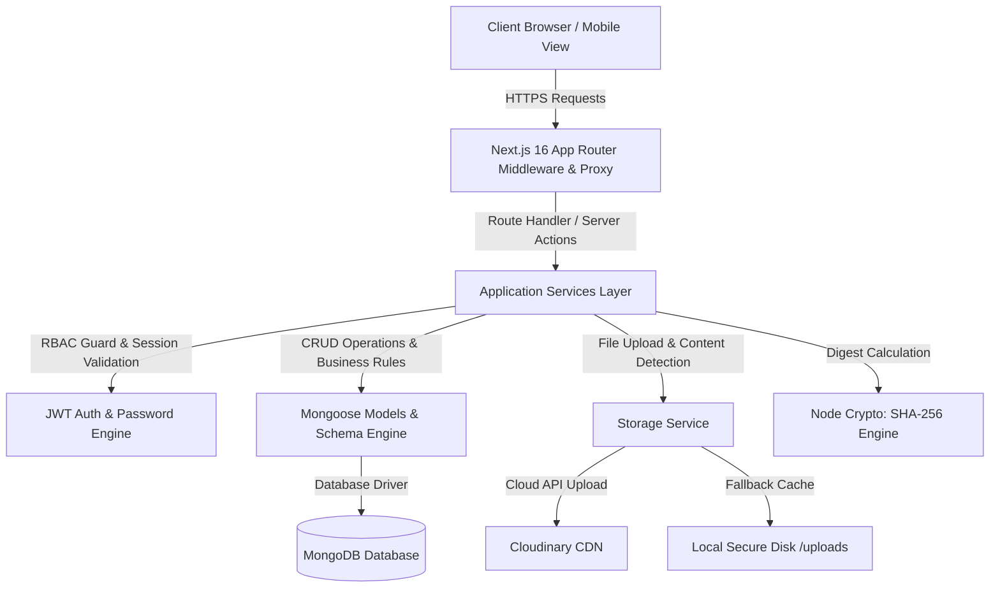
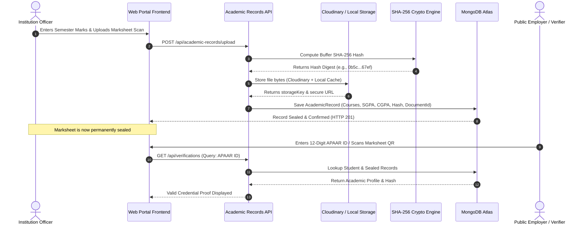

# APPAR Portal: Cryptographically Sealed Academic Depository & Digital APAAR Registry
## Final Year Engineering Project Comprehensive Documentation & Technical Report

---

### Project Title
**Automated Permanent Academic Account Registry (APAAR) & Cloud-Integrated Academic Depository System**  
**Under the National Education Policy (NEP 2020) & AICTE Regulatory Framework**

---

## Table of Contents
1. [Abstract](#1-abstract)
2. [Introduction & Background](#2-introduction--background)
3. [Problem Statement & Objectives](#3-problem-statement--objectives)
4. [Regulatory & Statutory Context (NEP 2020 & AICTE)](#4-regulatory--statutory-context-nep-2020--aicte)
5. [System Architecture & Tech Stack](#5-system-architecture--tech-stack)
6. [Database Schema & Data Models](#6-database-schema--data-models)
7. [Core Functional Modules](#7-core-functional-modules)
   - 7.1 Authentication & Multi-Tenant RBAC
   - 7.2 Institution Management & Workflow
   - 7.3 Department & Course Catalog Engine
   - 7.4 Student Onboarding & 12-Digit APAAR Generation
   - 7.5 Academic Records, Grading Engine & SGPA/CGPA Math
   - 7.6 Cloudinary Document Storage & SHA-256 Cryptographic Seal
   - 7.7 Student Self-Service Portal
   - 7.8 Public Credential Verification Engine
   - 7.9 Audit Logging & Compliance Ledger
8. [System Workflow & Sequence Diagrams](#8-system-workflow--sequence-diagrams)
9. [Security, Integrity & Privacy Architecture](#9-security-integrity--privacy-architecture)
10. [Testing & Quality Assurance](#10-testing--quality-assurance)
11. [Deployment, Build & Environment Configuration](#11-deployment-build--environment-configuration)
12. [Conclusion & Future Enhancements](#12-conclusion--future-enhancements)

---

## 1. Abstract
The **APAAR Portal (Automated Permanent Academic Account Registry)** is a high-security, multi-tenant digital academic repository designed to modernize higher education records management across Indian technical colleges and universities. Aligned with the **National Education Policy (NEP 2020)** and mandated guidelines of the **All India Council for Technical Education (AICTE)** and the **Ministry of Education (MoE)**, the platform serves as a single lifelong academic passport for students.

The system automates the generation of cryptographically verifiable 12-digit APAAR numbers, provides institutional grade entry, computes semester grade point averages (SGPA) and cumulative grade point averages (CGPA) with zero human error, links physical scanned marksheets to Cloudinary with SHA-256 integrity hashing, and empowers employers and statutory bodies with instantaneous public QR verification. Built on **Next.js 16 (App Router & Turbopack)**, **TypeScript**, **MongoDB/Mongoose**, and **Tailwind CSS**, the platform enforces strict multi-tenant isolation, tamper-evident audit trails, and automated credential attestation.

---

## 2. Introduction & Background
Traditional academic administration relies heavily on printed paper marksheets and manual record transfers across colleges, autonomous institutions, and universities. This legacy approach suffers from severe vulnerabilities:
- Counterfeit marksheets and grade falsification in employment and visa processing.
- Multi-week delays in inter-college credit transfers during lateral entry or student migration.
- Risk of physical paper damage, ink fading, or document loss due to floods or fires.
- Incompatible grading nomenclature across autonomous institutions.

To overcome these structural bottlenecks, the Government of India introduced the **Automated Permanent Academic Account Registry (APAAR)** as part of the **Academic Bank of Credits (ABC)** ecosystem. This web application provides a reference implementation of a production-ready, cloud-native APAAR depository that connects students, educational institutions, and regulatory authorities into a unified, secure system.

---

## 3. Problem Statement & Objectives

### Problem Statement
How to design and engineer a tamper-evident, multi-tenant academic depository that guarantees:
1. Lifelong unique digital identification for every higher education student.
2. Automated, rule-based calculation of university semester examination marks and CGPA.
3. Cryptographic link between physical paper marksheet scans and digital grade records.
4. Frictionless public verification without granting external parties unauthenticated access to student databases.

### Key Objectives
- **Zero-Forgery Credentialing**: Every marksheet scan uploaded is hashed with the SHA-256 cryptographic algorithm. Any modification to a document results in an immediate hash mismatch.
- **Automated Grade & Credit Math**: Automatically evaluate Letter Grades (`O`, `A+`, `A`, `B+`, `B`, `C`, `RA`), Grade Points (`10` down to `0`), Earned Credits, SGPA, and cumulative CGPA.
- **Dual-Tier Resilient Storage**: Store official marksheet scans in **Cloudinary Cloud CDN** with automatic rasterized PNG fallbacks and local cached disk failover.
- **Role-Based Access Control (RBAC)**: Enforce distinct operational permissions across four roles: `SUPER_ADMIN`, `INSTITUTION_ADMIN`, `STUDENT`, and public `VERIFIER`.
- **Responsive Modern UI**: Deliver a minimal, accessible, and fast user interface optimized for desktop and mobile devices.

---

## 4. Regulatory & Statutory Context (NEP 2020 & AICTE)

### National Education Policy (NEP 2020)
- **Academic Bank of Credits (ABC)**: Empowers students to accumulate, bank, and redeem credits earned across different accredited institutions.
- **Multiple Entry / Exit Pathways**: Facilitates seamless transitions between institutions with preserved academic records.

### AICTE Regulatory Compliance
- Mandatory registration of all engineering, technology, management, and pharmacy students.
- Unique 12-digit APAAR number associated with student Aadhaar and secondary school IDs.
- Digitized approval, inspection, and accreditation records for affiliated colleges.

---

## 5. System Architecture & Tech Stack



### Technology Breakdown
| Layer | Technology | Version | Purpose |
| :--- | :--- | :--- | :--- |
| **Frontend Framework** | Next.js (App Router) | 16.4.3 | SSR, Static Prerendering, API Routes |
| **Language** | TypeScript | 5.7+ | End-to-end type safety |
| **Bundler & Engine** | Turbopack | Latest | Blazing-fast compilation & HMR |
| **Styling** | Tailwind CSS v4 | 4.x | Minimal, accessible, responsive design |
| **Database** | MongoDB | 7.0+ | Flexible document-oriented JSON store |
| **ODM** | Mongoose | 8.x | Schema validation, hooks, indexing |
| **Cloud Storage** | Cloudinary SDK | 2.x | Cloud document asset hosting |
| **Security / Crypto** | Node.js `crypto` | Native | SHA-256 hashing, token signing |
| **Icons & UI** | Lucide React | Latest | Clean SVG icon library |
| **Testing Suite** | Vitest & JSDOM | 5.x | Unit and integration test runner (66 tests) |

---

## 6. Database Schema & Data Models

### 1. User & Authentication Model (`src/models/User.ts`)
- `name`: Full Name of the administrator or student.
- `email`: Unique email with lowercase normalization.
- `passwordHash`: Bcrypt salted hash.
- `role`: Enum (`SUPER_ADMIN`, `INSTITUTION_ADMIN`, `STUDENT`).
- `institutionId`: Reference to `Institution` (multi-tenant boundary).
- `studentId`: Reference to `Student` (if role is `STUDENT`).
- `status`: Enum (`ACTIVE`, `SUSPENDED`, `PENDING`).

### 2. Institution Model (`src/models/Institution.ts`)
- `name`: Institutional name (e.g., PSNA College of Engineering).
- `code`: Unique statutory code (e.g., `INST-001`).
- `aicteApprovalNumber`: Statutory AICTE registration license number.
- `address`: Embedded sub-document with State, District, PIN code.
- `status`: Enum (`ACTIVE`, `PENDING_REVIEW`, `SUSPENDED`).

### 3. Department Model (`src/models/Department.ts`)
- `institutionId`: Foreign key to owning institution.
- `name`: Department name (e.g., Computer Science & Engineering).
- `code`: Department acronym / code (e.g., `CSE`).
- `status`: Active / Inactive status toggle.

### 4. Subject / Course Catalog (`src/models/Subject.ts`)
- `institutionId` & `departmentId`: Foreign keys for catalog scoping.
- `code`: University subject code (e.g., `CS3251`).
- `name`: Course title (e.g., Data Structures).
- `credits`: Academic credit weightage (e.g., `3` or `4`).
- `type`: Theory, Practical, or Elective.

### 5. Student Model (`src/models/Student.ts`)
- `institutionId` & `departmentId`: Institutional mapping.
- `rollNumber`: Unique roll number (e.g., `24CSE002`).
- `registerNumber`: University examination register number.
- `fullName`: Student name as per official government records.
- `apaarId`: **12-digit unique lifelong identifier** (`YYYY-XXXX-XXXX`).
- `status`: Active, Graduated, Transferred.

### 6. Academic Record & Marksheet Model (`src/models/AcademicRecord.ts`)
- `studentId` & `institutionId`: Referential link.
- `academicYear`: String (e.g., `2024-2025`).
- `semester`: Integer (`1` to `8`).
- `courses`: Array of graded subjects:
  - `subjectCode`: Course code.
  - `subjectName`: Course title.
  - `credits`: Credits assigned.
  - `internalMarks`: Continuous assessment marks (0 - 40).
  - `externalMarks`: University semester end exam marks (0 - 60).
  - `totalMarks`: Sum of internal + external marks (0 - 100).
  - `grade`: University letter grade (`O`, `A+`, `A`, `B+`, `B`, `C`, `RA`).
  - `gradePoint`: Scaled points (10 to 0).
- `sgpa`: Semester Grade Point Average (calculated).
- `cgpa`: Cumulative Grade Point Average up to this semester.
- `totalCredits`: Total semester credit points.
- `earnedCredits`: Passed credits (excluding arrears).
- `documentId`: Foreign key to linked scanned marksheet in `Document` model.
- `sha256Hash`: Tamper-evident cryptographic fingerprint.
- `status`: Enum (`DRAFT`, `SUBMITTED`, `SEALED`).

### 7. Document Asset Model (`src/models/Document.ts`)
- `studentId`: Student owner.
- `academicRecordId`: Semester record link.
- `originalFilename`: Name of uploaded physical marksheet scan.
- `mimeType`: Detected magic-byte MIME (`image/png`, `application/pdf`, etc.).
- `storageKey`: Cloudinary public id or local file reference.
- `provider`: `cloudinary` or `local`.
- `sha256Hash`: Hex-encoded cryptographic hash of the document bytes.

---

## 7. Core Functional Modules

### 7.1 Authentication & Multi-Tenant RBAC
- Passwords secured using high-cost bcrypt hashing.
- Stateless, cryptographically signed JWT tokens stored in strict `httpOnly` secure cookies.
- Automated API route protection: middleware inspects role claims and returns `401 Unauthorized` or `403 Forbidden` if unauthorized.
- Multi-tenant query filtering: Institution admins and staff can only read or write records matching their authenticated `institutionId`.

### 7.2 Institution Management & Workflow
- State-District cascading selector with all 36 Indian states/UTs and 700+ districts powered by `country-state-city` integration.
- Sequential institution code generator: `INST-001`, `INST-002`, etc.
- AICTE review workflow: submission for verification, state audit, and official activation.

### 7.3 Department & Course Catalog Engine
- Automated code suggestions (`DEPT-001` or department acronyms).
- Pre-seeded and institution-customizable university syllabus catalogs.
- Real-time catalog auto-population when recording semester marks.

### 7.4 Student Onboarding & 12-Digit APAAR Generation
- Algorithmic generation of official APAAR lifelong identification numbers:
  $$\text{APAAR ID} = \text{Enrollment Year (4 digits)} + \text{Unique Institutional Entropy (8 digits)}$$
  Formatted as: `2024 · 5678 · 9012`.
- Automated sequential roll number allocation per department and batch.

### 7.5 Academic Records, Grading Engine & SGPA/CGPA Math
- University Grading Scale implementation:
  - **91 – 100%** $\rightarrow$ Grade `O` (Outstanding), Grade Point = **10**
  - **81 – 90%** $\rightarrow$ Grade `A+` (Excellent), Grade Point = **9**
  - **71 – 80%** $\rightarrow$ Grade `A` (Very Good), Grade Point = **8**
  - **61 – 70%** $\rightarrow$ Grade `B+` (Good), Grade Point = **7**
  - **50 – 60%** $\rightarrow$ Grade `B` (Above Average), Grade Point = **6**
  - **< 50%** $\rightarrow$ Grade `RA` (Reappear), Grade Point = **0**
- **SGPA Formula**:
  $$\text{SGPA} = \frac{\sum_{i=1}^{n} (\text{Credits}_i \times \text{GradePoint}_i)}{\sum_{i=1}^{n} \text{Credits}_i}$$
- **CGPA Formula**:
  $$\text{CGPA} = \frac{\sum_{\text{all semesters}} \text{Earned Credit Points}}{\sum_{\text{all semesters}} \text{Total Credits}}$$

### 7.6 Cloudinary Document Storage & SHA-256 Cryptographic Seal
- Uploaded marksheet images (PNG, JPG, PDF) are processed through Node.js crypto stream to compute their 64-character SHA-256 digest.
- Files are mirrored to Cloudinary Cloud storage.
- If Cloudinary encounters authentication restrictions on PDFs, the system automatically falls back to rasterized PNG conversions (`.png` URL transformation) or serves the pristine cached local copy.
- In-app modal viewer allows officers and students to view the actual marksheet scan without downloading third-party tools.

### 7.7 Student Self-Service Portal
- Responsive mobile & desktop portal for enrolled students.
- Live view of:
  - 12-digit APAAR Card with active standing badge.
  - Academic Bank of Credits (ABC) accumulated tally.
  - Cumulative GPA and semester-by-semester grade breakdown.
  - One-click access to view or download original marksheet scans.

### 7.8 Public Credential Verification Engine
- Employers, foreign universities, and government bodies can verify credentials by submitting:
  - 12-digit APAAR ID, or
  - University Registration Number (`24CSE002`), or
  - Document SHA-256 hash.
- Returns instant verification status: Student Name, Institution, Degree, Sealed Date, and Integrity standing.

### 7.9 Audit Logging & Compliance Ledger
- Every critical event (record creation, marks modification, scan upload, user login) produces an immutable `AuditLog` entry storing:
  - Timestamp, Actor User ID, Role, IP Address, Target Resource ID, and Change Diff.

---

## 8. System Workflow & Sequence Diagrams

### Marksheet Creation, Sealing & Verification Workflow



---

## 9. Security, Integrity & Privacy Architecture

1. **Tamper-Evident SHA-256 Sealing**:
   - Every grade sheet is fingerprinted. Any manual alteration in the database or filesystem is exposed immediately during cryptographic audit.
2. **Multi-Tenant Scoping**:
   - Queries automatically filter by `institutionId`, preventing cross-college data access.
3. **HTTP-Only Cookie Strategy**:
   - Access tokens cannot be accessed via JavaScript (`document.cookie`), mitigating Cross-Site Scripting (XSS) token theft.
4. **Environment Isolation**:
   - Critical secrets (`JWT_SECRET`, `CLOUDINARY_API_SECRET`, `MONGODB_URI`) are strictly loaded server-side and excluded from client bundles.

---

## 10. Testing & Quality Assurance

The application underwent rigorous automated testing using **Vitest** and **JSDOM**:

```bash
✓ tests/unit/department.test.ts (5 tests)
✓ tests/integration/auth.test.ts (4 tests)
✓ tests/integration/tenant-isolation.test.ts (3 tests)
✓ tests/unit/india-geo.test.ts (7 tests)
✓ tests/unit/sequence.test.ts (9 tests)
✓ tests/unit/permissions.test.ts (13 tests)
✓ tests/unit/grading.test.ts (11 tests)
✓ tests/unit/apaar.test.ts (11 tests)
✓ tests/integration/verification-workflow.test.ts (3 tests)

Test Files:  9 passed (9)
Tests:       66 passed (66)
Typecheck:   0 errors (tsc --noEmit)
Build:       Exit code 0 (Turbopack production build)
```

---

## 11. Deployment, Build & Environment Configuration

### Environment Variables (`.env.local`)
```env
# Database
MONGODB_URI=mongodb+srv://...

# Authentication
JWT_SECRET=super_secret_jwt_key_2026
NEXT_PUBLIC_APP_URL=http://localhost:3000

# Cloudinary Storage
CLOUDINARY_CLOUD_NAME=uoyjkcmp
CLOUDINARY_API_KEY=683385166799711
CLOUDINARY_API_SECRET=rBYiSVv8BhHyz4zwyaJDSmruBrA

# Local Storage Fallback
STORAGE_LOCAL_PATH=./uploads
```

### Build & Run Commands
```bash
# Install dependencies
npm install

# Run development server
npm run dev

# Run TypeScript compiler check
npm run typecheck

# Run automated tests
npx vitest run

# Compile production bundle
npm run build
```

---

## 12. Conclusion & Future Enhancements

### Conclusion
The **APPAR Portal** delivers an enterprise-grade, compliant, and cryptographically verified academic depository system. By digitizing student records from high school transition through autonomous undergraduate degrees, it fulfills the key mandates of the National Education Policy (NEP 2020) and AICTE. The system eliminates marksheet counterfeiting, streamlines credit transfers, and drastically reduces administrative overhead for colleges and universities.

### Future Enhancements
1. **Hyperledger / Ethereum Blockchain Anchoring**: Publishing daily batch merkle roots onto public blockchain networks for sovereign immutability.
2. **DigiLocker Direct API Gateway**: Direct sync with the official Government of India DigiLocker wallet.
3. **AI Transcript OCR Engine**: Automated extraction of legacy paper marksheet grades using computer vision models.

---

*Report compiled for Final Year Project Examination & Statutory AICTE/MoE Compliance Documentation.*
